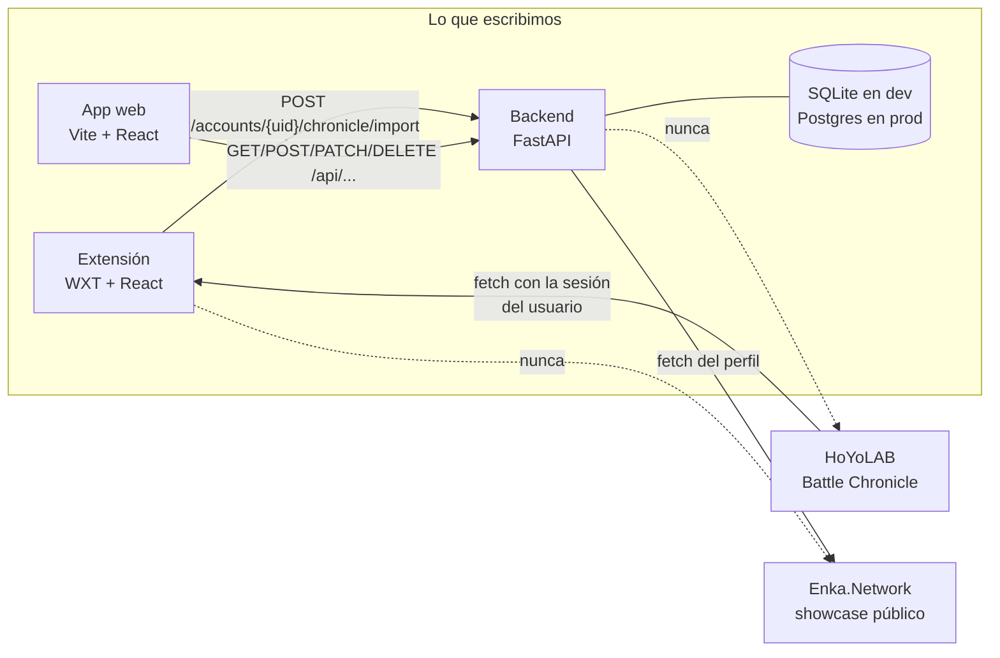
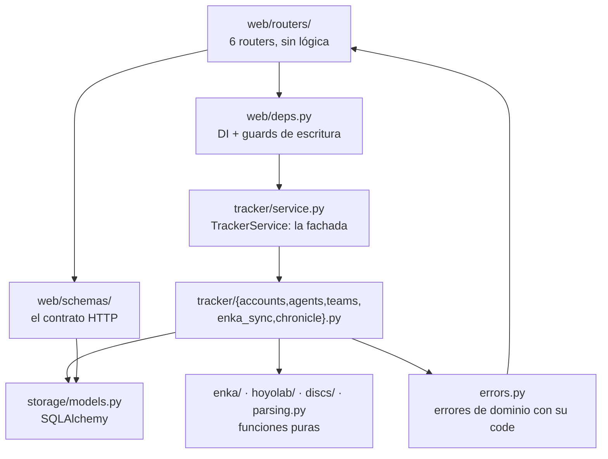

# Arquitectura — cómo encajan las piezas

Las tres mitades, qué puede llamar a qué, y las capas de cada una. Leelo antes de agregar una
dependencia entre módulos, antes de mover algo de carpeta y antes de asumir que dos piezas se
hablan.

Los datos que viajan por estos caminos están en [`03-FLUJO-DE-DATOS.md`](03-FLUJO-DE-DATOS.md); las
carpetas, una por una, en [`08-MAPA-DEL-REPO.md`](08-MAPA-DEL-REPO.md).

Fuentes: `src/zzz_tracker/app.py`, `web/deps.py`, `tracker/service.py`, `frontend/src/`,
`extension/`.

---

## 1. Las tres mitades y los dos mundos de afuera



Las dos flechas punteadas son la arquitectura, no un detalle de implementación:

**El backend no le habla a HoYoLAB.** No hay cliente HTTP, no hay cookies guardadas, no hay cron.
Lo único que sabe de HoYoLAB son *mappers*: funciones que reciben un payload ya capturado. El
porqué está en `docs/HOYOLAB.md` y resumido en [`07-NOTAS-PARA-IA.md`](07-NOTAS-PARA-IA.md).

**La extensión no le habla a Enka.** Sólo captura HoYoLAB y postea. Enka es asunto del backend, que
puede pedirlo desde cualquier IP porque es público y no necesita sesión.

**El frontend no comparte código con el backend.** Se hablan sólo por HTTP.
`frontend/src/api/types.ts` es un espejo **escrito a mano** de los schemas de pydantic: no se
genera. Si cambia un campo, se cambian los dos lados (el contrato está en
[`05-CONTRATO-API.md`](05-CONTRATO-API.md)).

---

## 2. El backend por capas



Las reglas que sostienen ese dibujo:

| Regla | Qué significa |
| --- | --- |
| **Un router no tiene lógica.** | Recibe, delega en `TrackerServiceDep`, devuelve un schema. Ninguno abre una `Session`: hoy ningún router importa `SessionDep`. |
| **Un router no arma respuestas a mano.** | Los `from_account` / `from_agent` / `from_run` viven en `web/schemas/`, que sí lee los modelos. |
| **`tracker/` y `storage/` no conocen `web/`.** | La dependencia va en una sola dirección. Hoy no hay ni un `from zzz_tracker.web` en esas dos carpetas, y romperlo es empezar a poder importar HTTP desde el dominio. |
| **Los mappers no conocen el ORM.** | `enka/mapper.py` y `hoyolab/` devuelven dataclasses `Parsed*`. De `storage.models` importan constantes (`MODE_SHIYU_DEFENSE`), nunca una clase mapeada. Por eso se testean con un dict y sin base. |
| **El dominio levanta errores, no respuestas.** | `errors.py` define la jerarquía y su `code`; `register_exception_handlers` los traduce a JSON en un solo lugar. Un servicio nunca devuelve un `JSONResponse`. |
| **Un `code` de error es contrato.** | Renombrarlo rompe clientes. Ver [`05-CONTRATO-API.md`](05-CONTRATO-API.md) §2. |

### Inyección de dependencias

`create_app()` cuelga cuatro cosas de `app.state`: `settings`, `db` (`DatabaseManager`), `enka`
(`EnkaClient`) y `static` (`StaticData | None`). `web/deps.py` las expone como alias `*Dep`, y
`get_tracker_service` arma **un `TrackerService` por request** con la sesión de ese request.

Eso es lo que hace que los tests no necesiten monkeypatch: `create_app(settings=..., enka=...,
static=...)` recibe los colaboradores por parámetro, y `conftest.py` le pasa un cliente de Enka
falso y un recorte de datos estáticos.

`StaticData` es opcional a propósito: el backend arranca sin haber corrido `sync-static`. Lo que no
puede funcionar sin eso —el catálogo— pide `RequiredStaticDataDep`, que contesta 503 en vez de
devolver listas vacías.

### La fachada y sus cinco colaboradores

`TrackerService` no tiene lógica propia: delega. Existe para que partir el service en cinco no
obligara a tocar 200 imports ni un solo test (ver [`07-NOTAS-PARA-IA.md`](07-NOTAS-PARA-IA.md)).

| Colaborador | De qué es dueño |
| --- | --- |
| `AccountService` | Cuentas rastreadas, y las keys que las poseen (`claim`, `rotate`, `verify`). |
| `AgentService` | El roster y las builds: alta a mano, edición, borrado, y el upsert que viene de un sync. |
| `TeamService` | Las comps y sus tres slots. |
| `EnkaSyncService` | El pull a Enka y el ttl que Enka reporta. |
| `ChronicleImporter` | El bundle que postea la extensión, sección por sección. |
| `tracker/rows.py` | Dos helpers que usan todos: `get_or_create` y `copy_fields`. |

Los cinco reciben la misma `Session` y **ninguno commitea a mitad de camino** salvo donde el flujo
lo exige (el import commitea al final; emitir una key commitea sola, porque la key se devuelve una
vez y no puede perderse si algo falla después).

---

## 3. Los dos orígenes de datos, y por qué no se mezclan

| | **Enka.Network** | **HoYoLAB Battle Chronicle** |
| --- | --- | --- |
| Quién lo pide | El backend, directo | La extensión, en el navegador del usuario |
| Necesita sesión | No, es público | Sí, la del usuario |
| Cómo entra | `POST /accounts` y `POST /accounts/{uid}/sync` | `POST /accounts/{uid}/chronicle/import` |
| Qué trae | Showcase: perfil y las builds que el jugador expuso | Todo: roster completo, bangboos, Shiyu, Asalto, Lost Void, builds |
| Valores | **Base**, no los que muestra el juego → [`06-DOMINIO.md`](06-DOMINIO.md) | Ya calculados |
| Frescura | Un ttl que Enka reporta (default 60 s) | Cuando el usuario aprieta importar |
| `source` de la fila | `enka` | `hoyolab` |

Los dos escriben sobre las mismas tablas, y lo que evita que se peleen es una sola regla:
**`is_manual` le gana a cualquier sync**. Un agente que el usuario editó a mano queda congelado
para los dos orígenes. El detalle está en [`04-MODELO-DE-DATOS.md`](04-MODELO-DE-DATOS.md) §4.1.

---

## 4. El frontend por capas

```
frontend/src/
├── App.tsx        el router; todas las rutas viven bajo <AppShell/>
├── pages/         una pantalla por ruta: pide datos y compone
├── components/    piezas de dominio (AgentCard, DiscCard, TeamForm, …)
│   └── ui/        el design system: AppShell, Hero, SectionHead, Tile, PortraitCard, …
├── hooks/         useApi, useAccountAccess, useAccountKey, useAgentArt, …
├── lib/           funciones puras: score, palette, labels, icons, stats, synergy, agentDraft
├── api/           client.ts (fetch + ApiError), errors.ts, types.ts (el espejo)
└── styles/        tokens.css + eridu.css: TODA la forma y el color
```

Las reglas:

- **Una pantalla no hace `fetch`.** Llama a `api.*` a través de `useApi`, que devuelve
  `{ data, error, loading, reload }` y descarta respuestas viejas por `requestId`. La tríada
  cargando / error / vacío se dibuja con `AsyncSection`, no a mano.
- **`lib/` es puro.** Sin React, sin red, sin DOM: por eso sus tests corren en node. El entorno
  `jsdom` está acotado por pragma a los dos archivos de pantallas que necesitan ciclo de vida
  (`interactions.test.tsx`, `writeActions.test.tsx`) y **no debe volverse global**.
- **No hay librería de estado.** El estado del servidor es cada `useApi`; lo compartido es un
  `SyncContext` mínimo (una versión y un `sync()`), y la key de la cuenta se lee del navegador con
  `useSyncExternalStore` (`useAccountKey`), así todas las pantallas ven el mismo valor.
- **La forma y el color salen de `styles/`.** Ninguna pantalla escribe un hex ni una geometría:
  las clases `.ne-*` viven en `eridu.css`, los colores en `tokens.css`, y el color por dominio sale
  de `lib/palette.ts`. Es la regla de `docs/DESIGN.md`, que es lectura obligatoria antes de tocar
  una pantalla.
- **Escribir necesita la key.** `client.ts` adjunta `X-Account-Key` **sólo** en las escrituras de
  esa cuenta, leyéndola de `lib/accountKey.ts`. Sin key, las pantallas se dibujan en modo lectura.

---

## 5. La extensión por dentro

Tres procesos, y la división no es estética: **sólo un content script corriendo en
`act.hoyolab.com` lleva la sesión del usuario en sus requests.**

| Pieza | Qué hace | Qué NO hace |
| --- | --- | --- |
| `entrypoints/hoyolab.content.ts` | El único que le pega a HoYoLAB. Recibe la orden, pide las secciones en serie con jitter, devuelve lo que trajo | No conoce el tracker, no guarda nada, no decide qué agentes pedir |
| `entrypoints/background.ts` | Orquesta: abre la pestaña, manda la orden, postea al tracker, guarda el snapshot y las keys | No hace fetch a HoYoLAB |
| `entrypoints/popup/`, `options/` | La UI: disparar el import, ver el progreso, configurar URLs y keys | No hace nada de red por su cuenta |
| `lib/` | Todo lo puro: `hoyolab.ts` (URLs y retcodes), `sync.ts` (armado del paquete), `roster.ts` (diff incremental), `builds.ts` (la pasada por agente), `chronicle.ts` (el payload), `tracker.ts` (el POST y el storage), `messages.ts` (el protocolo) | — |

El protocolo entre las tres es un puñado de mensajes tipados en `lib/messages.ts`
(`zzz-ping`, `zzz-run-sync`, `zzz-start-import`, `zzz-import-status`, `zzz-import-done`,
más los de progreso). El `zzz-ping` existe porque una pestaña recién abierta todavía no cargó su
content script: el background reintenta hasta 40 veces cada 500 ms.

El **snapshot del roster vive en el background**, no en el content script: el content script sólo
recibe con qué comparar y devuelve qué trajo. Así el que decide qué se guarda es el mismo que sabe
si el POST salió bien.

---

## 6. Los bordes que no se cruzan

Si estás por escribir una de estas líneas, pará y leé el documento que se indica:

| No | Por qué | Dónde está el porqué |
| --- | --- | --- |
| Un `fetch` a HoYoLAB en `src/` | Volvería a poner las cookies del usuario del lado del servidor | `docs/HOYOLAB.md` |
| Un `import` de `zzz_tracker.web` en `tracker/` o `storage/` | Da vuelta la dirección de la dependencia | §2 de acá |
| Una clase mapeada de SQLAlchemy en un mapper | Los mappers se testean sin base, con un dict | `notas/backend-mappers.md` |
| Código compartido entre `frontend/` y `src/` | Se hablan por HTTP; `types.ts` es un espejo a mano | `CLAUDE.md` |
| Un hex o un `px` en una pantalla | La forma y el color viven en `styles/` | `docs/DESIGN.md` |
| Un `[]` en vez de un 503 cuando faltan datos estáticos | Un catálogo vacío rompe pickers en silencio | `notas/backend-web.md` |
| Renombrar un `code` de error | Es contrato; `tests/test_errors.py` los pinea | [`05-CONTRATO-API.md`](05-CONTRATO-API.md) |

---

## 7. Cómo se sirve todo esto

Un solo deploy en Vercel: el estático del frontend, y `api/index.py` como función Python que
importa `create_app()`. El frontend siempre pide `/api/...` y el prefijo se borra en los dos
entornos —proxy de Vite en desarrollo, middleware `StripApiPrefix` en producción—. El detalle está
en [`05-CONTRATO-API.md`](05-CONTRATO-API.md) §4, y los pasos con credenciales en `docs/DEPLOY.md`.

La extensión no se despliega ahí: se buildea con WXT y se carga en el navegador. Apunta al tracker
por la URL que el usuario configure en sus opciones.
