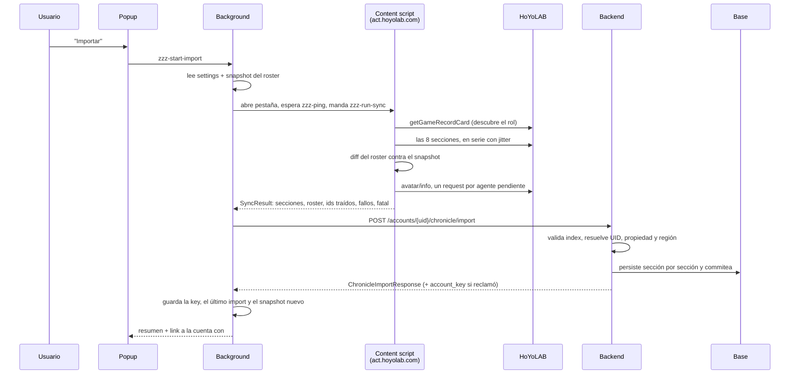
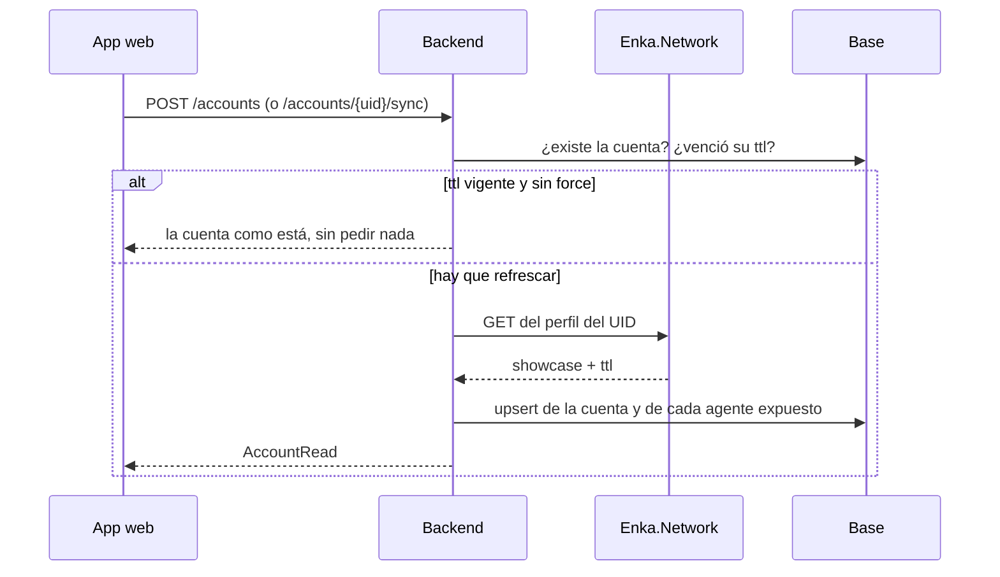
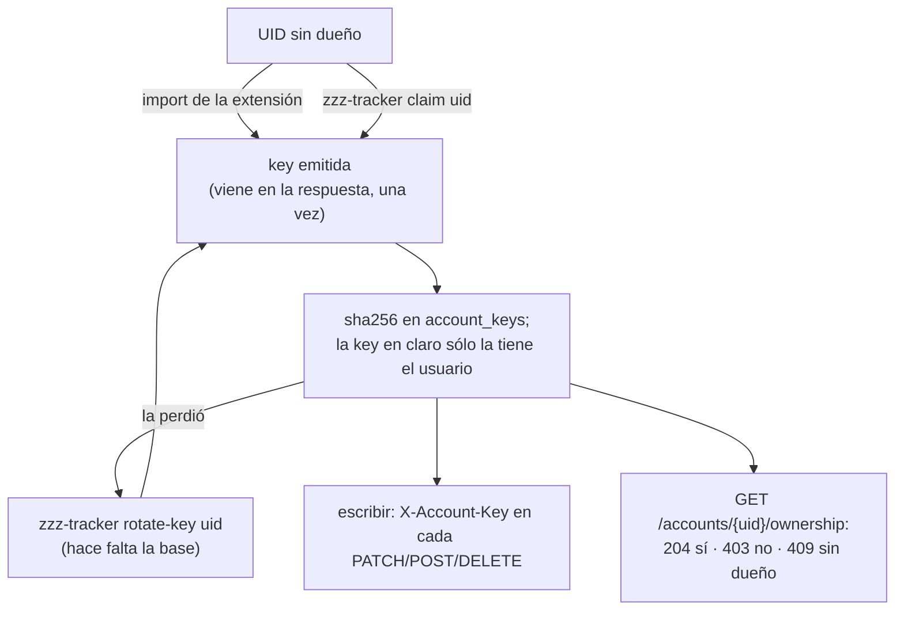
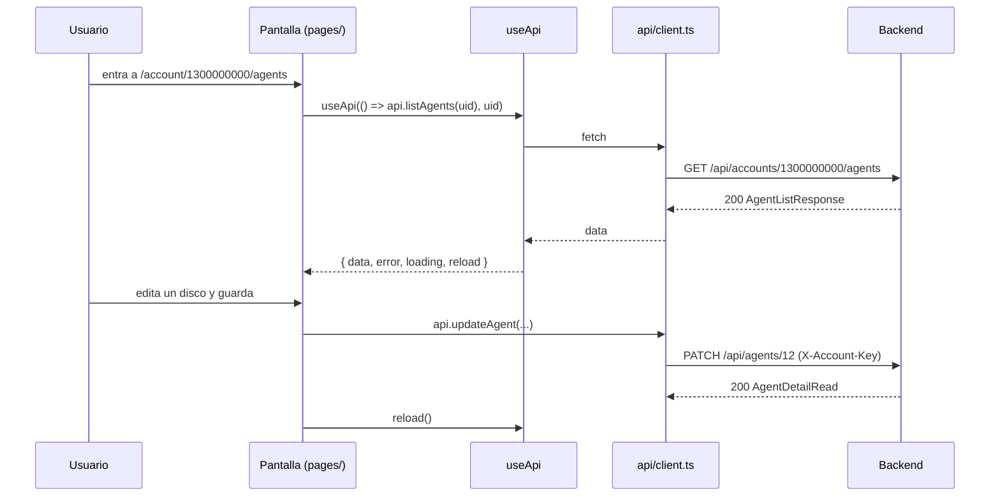

# Flujo de datos — cómo entra y sale cada dato

Los cuatro caminos por los que se mueve un dato en este tracker, paso por paso, y qué pasa cuando
uno se corta a la mitad. Leelo antes de tocar el import del Chronicle, el sync de Enka o la
propiedad de una cuenta.

Quién puede llamar a quién está en [`02-ARQUITECTURA.md`](02-ARQUITECTURA.md); qué devuelve cada
endpoint, en [`05-CONTRATO-API.md`](05-CONTRATO-API.md); dónde aterriza cada columna, en
[`04-MODELO-DE-DATOS.md`](04-MODELO-DE-DATOS.md).

Fuentes: `extension/`, `src/zzz_tracker/tracker/chronicle.py`, `tracker/enka_sync.py`,
`tracker/accounts.py`, `frontend/src/api/`, `frontend/src/hooks/`.

---

## Los cuatro caminos

| Camino | Lo dispara | Trae | Escribe |
| --- | --- | --- | --- |
| **1. Import del Chronicle** | El usuario, desde el popup de la extensión | Todo lo de HoYoLAB | Cuenta, roster, builds, bangboos, Shiyu, Asalto, Lost Void — y la key si la cuenta no tenía dueño |
| **2. Sync de Enka** | `POST /accounts` o `POST /accounts/{uid}/sync` | El showcase público | Cuenta y las builds que el jugador expuso |
| **3. Propiedad** | El import, o el CLI | Nada de afuera | `account_keys` |
| **4. Lectura y edición desde la web** | El usuario navegando | Lo que ya está en la base | Sólo lo que el usuario edita a mano, con key |

---

## 1. El import del Chronicle

El camino largo, y el único por el que entra un dato de HoYoLAB.

### Del lado de la extensión

**Quién hace el fetch importa.** Sólo el content script corre en `act.hoyolab.com`, y por eso sus
requests llevan la sesión del usuario. El background no puede pedirle nada a HoYoLAB; el content
script no sabe qué es el tracker.

**El orden de las 8 secciones** lo fija `syncSteps()` en `lib/sync.ts`: `index`, `avatar_basic`,
`buddy_info`, Shiyu actual y anterior, Asalto actual y anterior, `lost_void`. Van **en serie**, con
un jitter de 300–800 ms entre una y otra. `index` va primera porque sin ella el import no es válido.

**Sólo dos ciclos por modo.** HoYoLAB expone `schedule_type` 1 (actual) y 2 (anterior), y nada más:
la historia vieja no existe del lado de la API.

**El roster se diffea, no se re-pide entero.** `avatar/basic` trae todos los agentes con su
`{level, rank}` en un solo request; `avatar/info` es uno por agente (~36 agentes, ~50 s). Se piden
sólo los nuevos y los que cambiaron de nivel o de mindscape (`lib/roster.ts`).

> **El techo de esto, que no es un bug:** `avatar/basic` no dice nada del equipamiento. Un agente al
> que le cambiaste los discos sin subirlo de nivel **no se detecta**, y la única salida es
> "Reimportar todo". → `notas/extension.md`

**Un retcode decide si se sigue.** `classifyRetcode()` traduce el número a un `kind`, y
`STOP_KINDS` (`invalid_session`, `hard_limit`, `rate_limited`, `captcha`) corta la pasada. La
diferencia clave:

| Dónde cortó | ¿Fatal? | Qué pasa |
| --- | --- | --- |
| En las 8 secciones, con `invalid_session` o `hard_limit` | Sí | No se postea nada. Con sesión inválida la pestaña se deja abierta y visible para que el usuario se loguee |
| En las 8 secciones, con otro `kind` | No | La sección viaja como `null` y el import sube incompleto |
| En la pasada de builds | **Nunca** | El paquete ya tiene `index`, roster, bangboos y modos: sube igual, y los agentes que faltaron quedan pendientes |

**`null` y ausente no son lo mismo.** Una sección que se pidió y falló viaja como `null`; una que el
corte no llegó a pedir **no aparece en el paquete**. El backend distingue las dos cosas, así que no
las unifiques al armar el payload (`collectSections`).

**El snapshot se guarda después del POST, nunca antes.** Un agente sólo avanza a su marca actual si
su build viajó de verdad (`nextSnapshot`); guardarlo antes dejaría al día a agentes que nunca
llegaron, y no se volverían a pedir.

### Del lado del backend

`ChronicleImporter.import_chronicle()`, en orden:

1. **`index` es obligatoria.** Sin ella, `422`:
   `"A chronicle import needs at least the index payload"`.
2. **El UID del bundle tiene que ser el de la URL.** Sale de `record_card` o, si no vino, de
   `index`. Si no coinciden, `422`. (Que coincidan no prueba propiedad: un UID es público.)
3. **`find_or_create(uid)`** — un UID nuevo se empieza a rastrear acá, y la creación sobrevive la
   carrera de dos imports simultáneos.
4. **`_ensure_import_allowed`** — si la cuenta ya tiene dueño, hace falta su `X-Account-Key`; si no
   tiene, pasa cualquiera. Es la regla de [`05-CONTRATO-API.md`](05-CONTRATO-API.md) §Chronicle.
5. **La región** se toma del bundle sólo si es una que existe (`KNOWN_REGIONS`); si no, se deriva
   del UID.
6. **Se persiste sección por sección, y el orden importa** porque es el orden en que se reportan las
   saltadas: roster (`avatar_basic`) → bangboos (`buddy_info`) → temporadas (Shiyu y Asalto) →
   Lost Void → builds (`avatar_info`, última).
7. **Una sección ausente no es un error**: se anota en `skipped_sections` y el import sigue. Una
   temporada que existe pero vino sin datos va a `unavailable_modes`, que es otra cosa.
8. **Un solo commit al final**, más el `refresh` de la cuenta.
9. **`_claim_by_import`** decide si esta importación reclama la cuenta: si vino con la key correcta,
   sólo estampa `last_used_at`; si la cuenta no tenía dueño, emite la key y la devuelve. Es la única
   vez que esa key se puede leer.

Lo que el import escribe en la cuenta: `nickname` y `level` (del `record_card` o del `index`, el que
los tenga), `region`, `chronicle_public = True`, `chronicle_synced_at` y
`chronicle_import_source = 'extension'`.

**El payload crudo se guarda entero** en `agent_build_snapshots` y en el `raw` de cada fila. Por eso
un mapeo que hoy sale mal —Lost Void, ver `docs/PENDIENTES.md` §3— no pierde el dato: se arregla el
mapper y se reimporta.

---

## 2. El sync de Enka

El camino corto: lo pide el backend, sin sesión de nadie.

- **El ttl lo manda Enka**, y se guarda en `sync_ttl_seconds` (default 60 s si no viene).
  `is_sync_due()` decide; `?force=true` lo ignora.
- **Enka manda valores base**, no los que muestra el juego. Es la trampa del dominio:
  [`06-DOMINIO.md`](06-DOMINIO.md) §3.
- **Un agente `manual` no se pisa.** `upsert_enka_build` respeta `is_manual`
  ([`04-MODELO-DE-DATOS.md`](04-MODELO-DE-DATOS.md) §4.1).
- El showcase trae **sólo los agentes que el jugador expuso**: es normal que traiga 3 y el Chronicle
  36.
- `POST /accounts/{uid}/sync` **no pide key**: no escribe nada que el usuario haya elegido, sólo
  repite lo que Enka ya publica.

---

## 3. La propiedad de una cuenta

Sin login, lo único que separa a un dueño de un desconocido es la **account key**: una por UID.

Los tres lugares donde vive esa key, y ninguno es el servidor:

| Dónde | Qué guarda |
| --- | --- |
| Extensión | `browser.storage.sync`, una key por UID; la adjunta en el import de esa cuenta |
| Navegador de la app web | `localStorage`, una key por UID (`lib/accountKey.ts`); `client.ts` la adjunta sola en las escrituras |
| Base | **Sólo el sha256.** `verify_key` compara en tiempo constante |

**Cómo pasa de la extensión a la web:** el popup ofrece un link
`…/account/{uid}#key=<key>`. Va en el **fragmento**, no en el query, porque el fragmento no llega al
servidor ni a sus logs. Al abrirlo, `consumeKeyFromUrl` la guarda y **borra el fragmento de la
barra** con `history.replaceState`.

Las dos reglas que conviene no perder, con su precio:

- **Una cuenta con dueño no se toma con un import**, por completo que venga el bundle: `403`. El
  precio es que perder la key no se arregla desde el navegador — se arregla con
  `zzz-tracker rotate-key <uid>`, que exige acceso a la base.
- **Trackear un UID desde la web no lo reclama.** Escribir un número público en un formulario no
  dice de quién es la cuenta.

El porqué completo está en `docs/OWNERSHIP.md`.

---

## 4. La lectura y la edición desde la web

- **La key se adjunta sola**, y sólo en las escrituras de esa cuenta. Sin key la pantalla se dibuja
  en modo lectura: los botones de escribir no aparecen (no aparecen deshabilitados, no aparecen).
- **Cada pantalla pide lo suyo.** No hay caché ni store global: `useApi` descarta las respuestas de
  un pedido viejo comparando su `requestId`, y `reload()` es lo que refresca después de escribir.
- **El catálogo alimenta los pickers** (`/catalog/agents`, `/catalog/wengines`, `/catalog/discs`,
  `/catalog/properties`). Si faltan los datos estáticos de Enka contesta `503`, no `[]`, justamente
  para que un picker vacío no parezca un juego sin agentes.
- **Un error se muestra por su `code`, nunca por su texto.** `api/errors.ts` branchea por `code`
  (`unclaimed_account`, `forbidden`, `not_found`, …) y arma el mensaje del lado del frontend.

---

## Qué pasa cuando algo falla

| Falla | Quién la ve | Qué pasa |
| --- | --- | --- |
| Sesión de HoYoLAB vencida | Extensión | Import cancelado, la pestaña queda abierta para loguearse |
| Chronicle no público | Extensión | La sección falla; el resto del paquete viaja igual |
| Rate limit o captcha de HoYoLAB | Extensión | Corta la pasada; **no se reintenta solo** |
| `retcode 10041` (hard limit) | Extensión | Import cancelado entero |
| Un `avatar/info` que falla | Extensión → backend | Ese agente queda pendiente en el snapshot y se vuelve a pedir el próximo import |
| Una sección del bundle en `null` | Backend | Se anota en `skipped_sections`; el import sigue |
| Temporada sin datos | Backend | Va a `unavailable_modes`, que no es lo mismo que saltada |
| El bundle dice otro UID | Backend | `422`, nada se escribe |
| Import sobre una cuenta con dueño, sin su key | Backend | `403`, nada se escribe |
| Escritura sobre una cuenta sin dueño | Backend | `409 unclaimed_account` — no hay key que presentar todavía |
| Enka caído o limitando | Backend | `502` / `429`; la cuenta queda como estaba |
| Faltan los datos estáticos | Backend | `503` en el catálogo; el resto de la API anda |
| El navegador no deja guardar la key | App web | Se avisa y se pide copiarla a mano; sin storage no se puede recordar |
