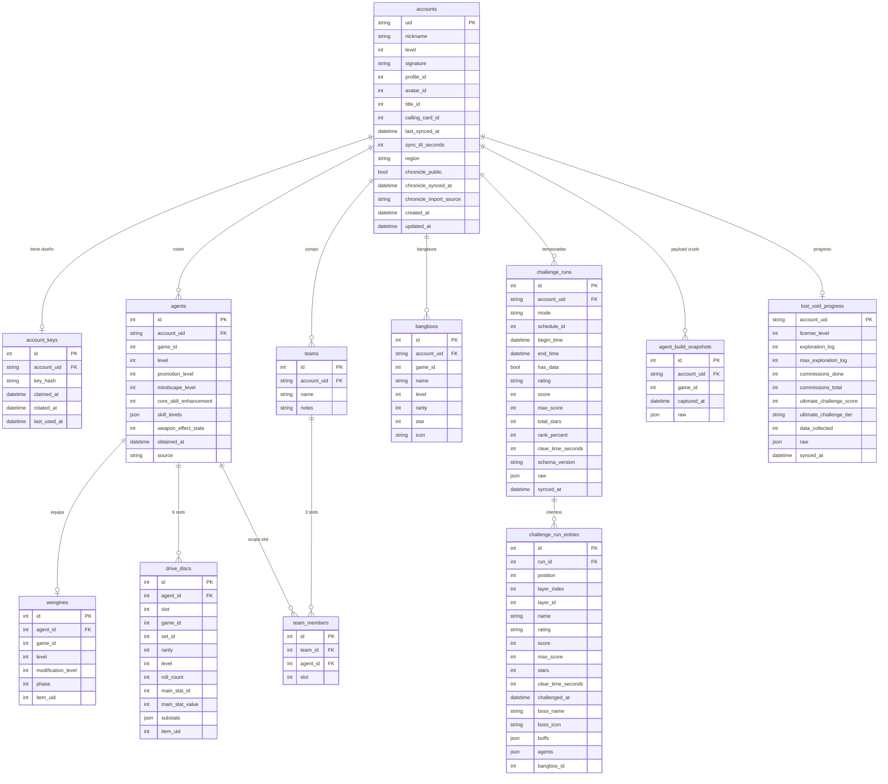

# Modelo de datos

Qué tablas hay, qué guarda cada columna, quién la escribe y qué reglas sostiene el código que
el esquema no puede expresar. Leelo antes de tocar `src/zzz_tracker/storage/models.py`, antes de
escribir una migración y antes de asumir que una restricción está en la base.

Fuente: `src/zzz_tracker/storage/models.py` y `alembic/versions/`.

---

## 1. Diagrama



Todas las FK hacia `accounts.uid` son `ON DELETE CASCADE`, y las relaciones ORM llevan
`cascade="all, delete-orphan"`: borrar una cuenta se lleva absolutamente todo lo suyo.

---

## 2. Tabla por tabla

### `accounts`

La cuenta rastreada. La PK **es el UID del juego**, un string, no un entero autogenerado: es el
identificador que ya existe afuera y el único que los dos orígenes de datos comparten.

| Columna | Tipo | Qué es |
|---|---|---|
| `uid` | `String(16)` PK | UID in-game. El patrón que valida la API es `^\d{6,16}$` |
| `nickname`, `level`, `signature` | `String(64)` / `Integer` / `Text` | Perfil público. `level` es el nivel Inter-Knot |
| `profile_id`, `avatar_id`, `title_id`, `calling_card_id` | `Integer?` | Ids de cosmético del perfil de Enka; el frontend los resuelve o los ignora |
| `last_synced_at` | `DateTime?` | Última corrida de Enka. `None` = nunca sincronizada |
| `sync_ttl_seconds` | `Integer` | El `ttl` que **Enka misma** informó en la respuesta anterior. Se usa para `next_sync_available_at()` |
| `region` | `String(16)` | Región de HoYoLAB (`prod_gf_eu`, …). Vacío hasta el primer import |
| `chronicle_public` | `Boolean` | Queda en `True` en cuanto un import escribe la cuenta |
| `chronicle_synced_at` | `DateTime?` | Último import de chronicle |
| `chronicle_import_source` | `String(16)?` | Cómo llegó el bundle. Hoy siempre `"extension"` (`CHRONICLE_SOURCE_EXTENSION`) |
| `created_at`, `updated_at` | `DateTime` | `updated_at` tiene `onupdate` |

Propiedades de Python que **no** son columnas: `is_claimed` (¿existe `account_keys`?),
`next_sync_available_at()` (`last_synced_at + sync_ttl_seconds`) e `is_sync_due()`.

**Quién la escribe:** el sync de Enka (`EnkaSyncService`) escribe perfil y ttl; el import de la
extensión (`ChronicleImporter`) escribe `nickname`, `level`, `region`, `chronicle_*`.

### `account_keys`

La key de escritura de una cuenta, **hasheada**. Una fila por cuenta (`unique` sobre
`account_uid`). Que la fila exista *es* lo que significa "esta cuenta tiene dueño".

| Columna | Tipo | Qué es |
|---|---|---|
| `key_hash` | `String(64)` | sha256 hex de la key. La key en claro no se guarda nunca |
| `claimed_at` | `DateTime` | Cuándo se reclamó |
| `rotated_at` | `DateTime?` | No nulo sólo si hubo una reemisión deliberada (`rotate-key`) |
| `last_used_at` | `DateTime?` | Se estampa en cada verificación exitosa |

**Quién la escribe:** el import que reclama la cuenta, y los comandos `zzz-tracker claim` /
`zzz-tracker rotate-key`. Nunca la edición manual.

### `agents`

Un agente rastreado de una cuenta. `UniqueConstraint(account_uid, game_id)`: un agente por
cuenta, no dos filas del mismo personaje.

| Columna | Tipo | Qué es |
|---|---|---|
| `game_id` | `Integer` | Id del personaje en los datos del juego |
| `level`, `promotion_level` | `Integer` | Nivel y ascensión |
| `mindscape_level` | `Integer` | Los "cinemas"; en el JSON de Enka viene como `TalentLevel` |
| `core_skill_enhancement` | `Integer` | Mejora de habilidad central |
| `skill_levels` | `JSON` | `{"<índice de habilidad>": nivel}`, con el índice como **string** |
| `weapon_effect_state` | `Integer?` | Estado del efecto del W-Engine, tal como lo manda Enka |
| `obtained_at` | `DateTime?` | Cuándo se obtuvo (`ObtainmentTimestamp`) |
| `source` | `String(16)` | `enka`, `hoyolab` o `manual`. Ver invariantes |

`is_manual` es una propiedad de Python: `source == "manual"`.

**Quién la escribe:** los tres. `AgentService.write_build` con `SOURCE_ENKA` desde el sync,
con `SOURCE_HOYOLAB` desde el import, y `SOURCE_MANUAL` desde `create_agent` / `update_agent`.

### `wengines`

El W-Engine equipado. `unique` sobre `agent_id`: cero o uno por agente.

| Columna | Qué es |
|---|---|
| `modification_level` | El `BreakLevel` de Enka |
| `phase` | El `UpgradeLevel` de Enka (las "fases" del arma) |
| `item_uid` | Id de la instancia concreta del ítem, cuando Enka lo manda |

### `drive_discs`

Un disco equipado. `UniqueConstraint(agent_id, slot)`.

| Columna | Qué es |
|---|---|
| `game_id` | Id de **la pieza**, no del set |
| `set_id` | Id del set, resuelto desde los datos estáticos (`StaticData.disc_set_id`) |
| `rarity` | 2 = B, 3 = A, 4 = S |
| `level` | Nivel de mejora del disco |
| `roll_count` | El `BreakLevel` de Enka: **procs** que recibió el disco, no rolls de un substat |
| `main_stat_id`, `main_stat_value` | Prop id y **valor base** del main stat |
| `substats` | `JSON`, lista de `{"prop_id": int, "value": int, "rolls": int}` |

Los valores son bases de Enka, no lo que muestra el juego. La conversión está en
`src/zzz_tracker/discs/values.py` y explicada en `06-DOMINIO.md`.

### `agent_build_snapshots`

El `avatar/info` crudo que trajo el último import para un agente.
`UniqueConstraint(account_uid, game_id)`: **una fila por agente, pisada en cada import**. No es
un historial. Es la válvula de escape para cualquier campo que el mapper todavía no lee.

**Quién la escribe:** sólo el import de la extensión.

### `teams`

Una comp con nombre. `name` (≤64) y `notes` libres. No hay unicidad de nombre.

### `team_members`

Un slot ocupado. `UniqueConstraint(team_id, slot)`. FK a `agents.id` con cascade, más un borrado
explícito de las filas en `AgentService.delete_agent`, así que borrar un agente vacía su slot y
deja la comp con el resto de sus miembros.

### `bangboos`

`UniqueConstraint(account_uid, game_id)`. `rarity` es numérica (el mapper traduce la letra que
manda HoYoLAB con `RARITY_BY_LETTER`), `star` es el nivel de estrellas y `icon` una URL.

**Quién la escribe:** sólo el import (`buddy_info`).

### `challenge_runs`

Una temporada de un modo de fin de juego.
`UniqueConstraint(account_uid, mode, schedule_id)`: una fila por temporada, actualizada en cada
import.

| Columna | Qué es |
|---|---|
| `mode` | `shiyu_defense` o `deadly_assault` (`MODE_*` en `models.py`) |
| `schedule_id` | El id de temporada de HoYoLAB. Las runs se ordenan por él, descendente |
| `has_data` | Si la temporada tiene algo jugado |
| `rating` | La letra del juego (`S`, `A`, …), `String(4)` |
| `rank_percent` | Percentil **×100** en entero. La API lo divide por 100 al servirlo |
| `schema_version` | Qué forma de payload leyó el mapper (`v1` / `v2`) |
| `raw` | `JSON` del payload de la temporada |

### `challenge_run_entries`

Un intento dentro de una temporada. `UniqueConstraint(run_id, position)`.

`layer_index` y `layer_id` dicen de qué capa/nodo salió el intento; ambos pueden ser `None`
cuando el ordinal de la clave no se reconoce. `buffs` y `agents` son listas JSON — `agents`
guarda la forma que sirve `ChallengeAgentRead` (`game_id`, `level`, `rarity` **como letra**,
`element`, `mindscape`, `icon`).

### `lost_void_progress`

Progreso de Lost Void / Hollow Zero. La PK **es** `account_uid`: como mucho una fila por cuenta.

---

## 3. Índice de migraciones

Están en `alembic/versions/`, nombradas `<fecha>_<revisión>_<qué>.py`.

| Rev | Archivo | Qué introdujo |
|---|---|---|
| `0001` | `20260805_0001_initial.py` | El núcleo de Enka: `accounts`, `agents`, `wengines`, `drive_discs`, `teams`, `team_members` |
| `0002` | `20260808_0002_hoyolab_chronicle.py` | Todo lo del Battle Chronicle: `bangboos`, `challenge_runs`, `challenge_run_entries`, `lost_void_progress`, la (ya desaparecida) `hoyolab_credentials`, y en `accounts` las columnas `region`, `chronicle_public`, `chronicle_synced_at`, `chronicle_failed_at` |
| `0003` | `20260811_0003_challenge_entry_layer.py` | `layer_index` y `layer_id` en `challenge_run_entries` |
| `0004` | `20260819_0004_chronicle_import_source.py` | `accounts.chronicle_import_source` |
| `0005` | `20260830_0005_agent_build_snapshots.py` | La tabla `agent_build_snapshots` |
| `0006` | `20260909_0006_account_keys.py` | La tabla `account_keys` (con una columna `claim_level` que `0007` borra). No hace backfill: una cuenta anterior a esta tabla queda sin dueño |
| `0007` | `20260909_0007_drop_hoyolab_credentials.py` | Borra `hoyolab_credentials`, `account_keys.claim_level` y `accounts.chronicle_failed_at`. El `downgrade` los repone vacíos |

Toda revisión tiene `downgrade()` real.

---

## 4. Los invariantes que el esquema no expresa

Esta es la parte que importa: nada de lo que sigue está en una constraint. Lo sostiene el código,
y si lo rompés la base te deja.

### 4.1 `is_manual` le gana a cualquier sync

`AgentService.write_build` arranca con:

```python
if agent is not None and agent.is_manual:
    return None
```

Un agente con `source == "manual"` **no lo pisa ni Enka ni un import**, para siempre. Y editarlo
por mano es lo que lo marca así: `update_agent` fuerza `agent.source = SOURCE_MANUAL` antes de
tocar nada. Consecuencia que vale decir en voz alta: corregir a mano un agente importado lo
congela contra futuros syncs.

`_upsert_roster_agent` (en `ChronicleImporter`) hace la misma verificación y devuelve `False`, así
que el agente ni siquiera cuenta en `agents_synced`.

### 4.2 Los tres valores de `source`

| Valor | Constante | Quién lo pone |
|---|---|---|
| `enka` | `SOURCE_ENKA` | El sync de Enka (`upsert_enka_build`). Es el default de la columna |
| `hoyolab` | `SOURCE_HOYOLAB` | El import: tanto el roster (`avatar_basic`) como la build completa (`avatar/info`) |
| `manual` | `SOURCE_MANUAL` | `create_agent` y `update_agent` |

`enka` y `hoyolab` **se pisan entre sí**: los dos describen la build tal como está en el juego, así
que gana el último que corre. Sólo `manual` está protegido. Dentro de un mismo import las builds
completas corren después del roster, para que la build gane sobre el nivel y el mindscape que
trajo `avatar_basic`.

### 4.3 Seis discos por agente, uno por slot

`DISC_SLOTS = 6` vive en `tracker/agents.py`. La unicidad de slot la garantizan dos cosas
distintas y ninguna es la base:

- `AgentService._ensure_one_disc_per_slot` levanta `ValidationError` si el pedido repite un slot;
- `UniqueConstraint(agent_id, slot)` en `drive_discs` es la red de seguridad.

**El rango `1..6` no lo valida el servicio**: lo valida el schema HTTP (`DriveDiscWrite.slot`, con
`ge=1, le=DISC_SLOTS`). Un `ParsedDisc` con `slot=9` que llegue por otra puerta se guardaría.

`_replace_discs` reemplaza por slot y **borra los slots que el pedido no menciona**: mandar discos
es mandar el set completo, no un parche.

### 4.4 Tres agentes por equipo, ninguno repetido

`TEAM_SLOTS = 3`, en `tracker/teams.py`. `_validate_members` chequea, en este orden:

1. entre 1 y 3 miembros;
2. cada `slot` entre 1 y 3;
3. ningún slot repetido;
4. **ningún `agent_id` repetido** — un agente no ocupa dos slots del mismo equipo;
5. cada agente pertenece a **esa misma cuenta**.

`UniqueConstraint(team_id, slot)` cubre el 3; el 4 y el 5 no tienen respaldo en la base.

Escribir un equipo lo reemplaza entero: `update_team` hace `team.members.clear()` antes de rellenar.

### 4.5 La región se deriva del UID cuando no viene

`region_for_uid(uid)` en `models.py`:

- **8 dígitos exactos → `prod_gf_cn`** (cliente chino);
- si no, por los dos primeros dígitos: `10` → `prod_gf_us`, `13` → `prod_gf_jp`, `15` → `prod_gf_eu`, `17` → `prod_gf_sg`;
- cualquier otro prefijo → `prod_gf_eu` (`DEFAULT_REGION`).

`AccountService.region_for` aplica eso y **levanta `ValidationError` si da `prod_gf_cn`**: el
tracker no lee cuentas chinas de HoYoLAB.

La región que manda el bundle se cree sólo si está en `KNOWN_REGIONS`; si no, se cae al UID
(`ChronicleImporter._import_region`). El mismo `KNOWN_REGIONS` es lo que valida `RegionField` en
los schemas.

> **Límite conocido:** `KNOWN_REGIONS` **incluye** `prod_gf_cn`. Un bundle que declare esa región
> explícitamente pasa por `_import_region` sin llegar nunca a `region_for`, y por lo tanto esquiva
> el rechazo de las cuentas chinas. El chequeo sólo actúa cuando la región hay que derivarla.

`AccountRead` sirve `account.region or region_for_uid(account.uid)`: una cuenta que nunca se
importó igual reporta una región, la que implica su UID.

### 4.6 Una cuenta sin dueño no tiene `AccountKey` — y por eso no hay key que la escriba

No hay estado intermedio: o existe la fila en `account_keys` o no. `is_claimed` es exactamente
`self.key is not None`.

Eso hace que "sin dueño" y "key equivocada" sean **dos respuestas distintas** y no la misma:
`UnclaimedAccountError` (409) frente a `ForbiddenError` (403). Ver `05-CONTRATO-API.md`.

El primer import de un UID lo reclama —no hay nada que robar en una cuenta que nadie tiene— y
devuelve la key esa única vez. Después de eso, la key es lo único que habla por la cuenta: ningún
bundle, por bien que nombre el UID, la pisa. El UID es público; el bundle lo elige quien lo manda.

### 4.7 Las keys se guardan hasheadas

`storage/keys.py`: `generate_key()` devuelve `zzk_` + `secrets.token_urlsafe(32)`, y lo que se
guarda es `hashlib.sha256(...).hexdigest()`. La key en claro **existe una sola vez**, en la
respuesta del import o en la salida del comando de CLI. Un dump de la base no da acceso de
escritura a nadie.

`verify_key` compara con `secrets.compare_digest`, a propósito: un `==` filtraría por timing
cuánto del prefijo acertaste. El prefijo `zzk_` está para que una key filtrada sea grepeable en
un log.

Reemitir una key (`rotate_key`) **invalida la anterior**: hay un solo `key_hash` por cuenta.

### 4.8 Datetimes: la base los devuelve naive

`utc_now()` guarda aware, pero SQLite los devuelve sin tzinfo. Por eso existe `as_utc()` y por eso
**todo schema de salida pasa sus datetimes por ahí**. Un `datetime` que sale de un modelo sin
`as_utc` es una comparación rota esperando ocurrir.

### 4.9 Topes de rareza y nivel: dónde están y dónde no

Los topes in-game que valida la API (`web/schemas/common.py`) son planos, no dependen de la
rareza: `MAX_DISC_LEVEL = 15`, `MAX_RARITY = 5`, `MAX_LEVEL = 60`, `MAX_MINDSCAPE_LEVEL = 6`…

> **Límite conocido:** el juego sí depende de la rareza (S llega a 15, A a 12, B a 9) y las
> rarezas reales de disco son 2..4, no 1..5. El schema acepta un disco B de nivel 15 o de rareza
> 5. No rompe nada: `main_stat_total` devuelve `None` para esa combinación, y el frontend muestra
> el valor sin escalar en vez de un número inventado. Los detalles están en `06-DOMINIO.md`.
